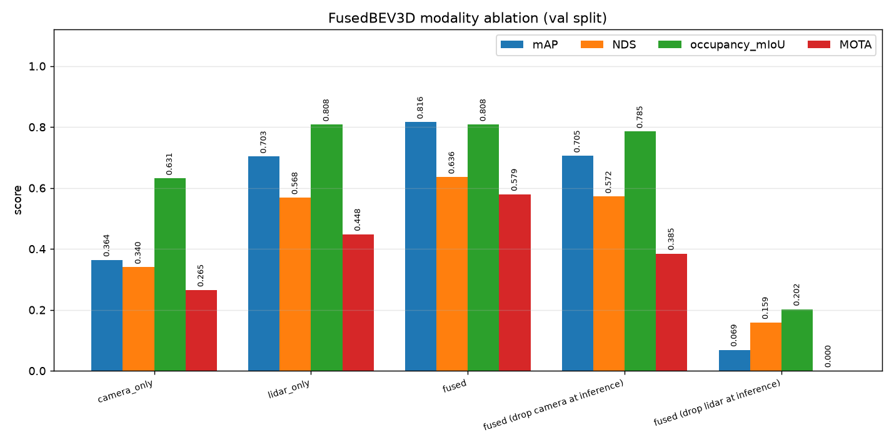
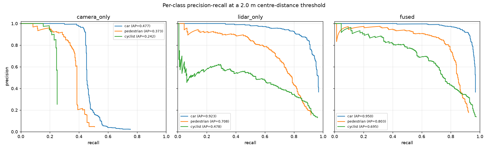
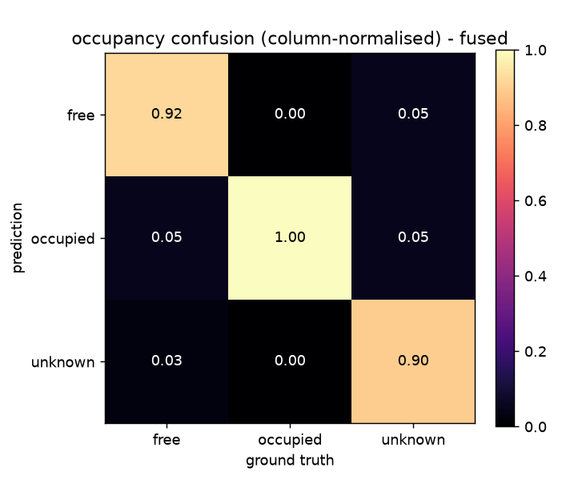
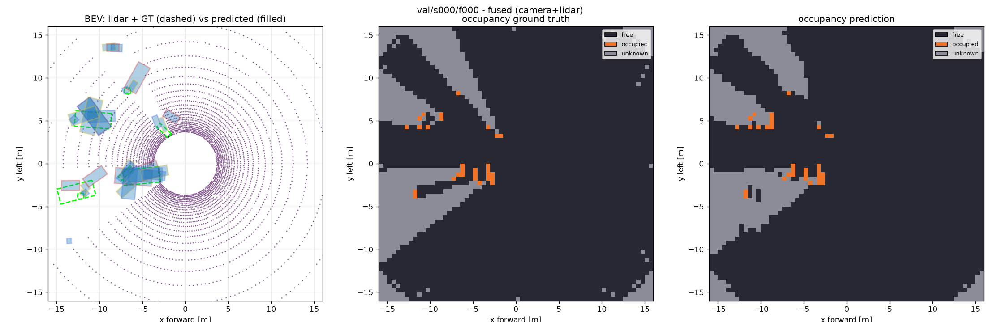
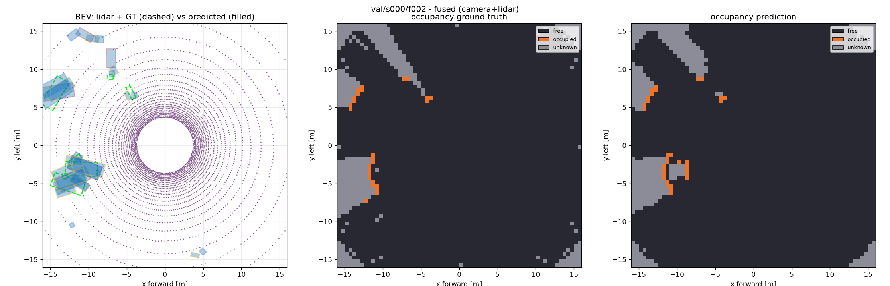

# FusedBEV3D

**Multi-modal (camera + lidar) bird's-eye-view perception in PyTorch.**
Center-based 3D object detection, Kalman/greedy multi-object tracking and 3-class
voxel occupancy prediction on one shared BEV grid — plus a modality-dropout
ablation that trains and evaluates camera-only, lidar-only and fused variants under
identical seeds, schedules and step budgets.

Everything runs end to end on a CPU-only laptop in minutes at a deliberately small
scale. Every number in this README was produced by a command in this repository and
is archived under `results/`; the source file for each number is cited inline.

---

## What it does

| Task | Head | Metrics | Artifact |
| --- | --- | --- | --- |
| 3D detection (car, pedestrian, cyclist) | `CenterHead` on the fused BEV map | per-class AP @ {0.5, 1, 2, 4} m, mAP, ATE/ASE/AOE/AVE, NDS-style aggregate | `results/detection_fused.json` |
| Multi-object tracking | constant-velocity Kalman filter + Hungarian association | CLEAR MOT: MOTA, MOTP, ID switches, FP/FN, MT/PT/ML, multi-gate average | `results/tracking_fused.json` |
| Voxel occupancy (free/occupied/unknown) | `OccupancyHead` reshaping BEV channels to `Z x C` | per-class IoU, mIoU, occupied precision/recall | `results/occupancy_fused.json` |
| Sensor ablation | modality switch inside `FusedBEV3D` | the same metrics for camera-only / lidar-only / fused and for inference-time dropout | `results/ablation.csv`, `results/ablation.md`, `results/ablation_full.json` |

---

## Architecture

```
 cameras (S = 3)                       lidar (32 beams x 192 azimuths)
      |                                          |
      v                                          v
 strided-conv CNN backbone              voxelize -> pillars (x,y columns)
      |                                          |
 per-pixel context  +  per-pixel        PointNet per pillar (7 -> 64 -> 64)
 depth distribution over D = 8 bins             |
      |                                   scatter to BEV via index_add_
 LSS lift: outer product                         |
  -> frustum point cloud (D*h'*w')        lidar BEV (B, 64, 64, 64)
      |                                          |
 frustum_grid(intrinsics,                        |
   extrinsics, grid) -> BEV cells               |
      |                                          |
 bev_pool = bucketed sum (index_add_)            |
 camera BEV (B, 48, 64, 64)                      |
      \                                        /
       \-- 1x1 conv to 64 ch, sum (missing  --/
           modality contributes zeros)
                          |
       BEV backbone: 2x down / 2x up with FPN skips
                          |
          +---------------+---------------+
          |                               |
     CenterHead                      OccupancyHead
  heatmap (3 x 64 x 64)            (Z x 3 x 64 x 64 logits)
  reg (10 x 64 x 64)                       |
          |                          argmax -> (Z, 64, 64)
  3x3 max-pool NMS + top-k
          |
  oriented 3D boxes (x,y,z,l,w,h,yaw,vx,vy)
          |
  Greedy3DTracker: Kalman CV filter + two-stage Hungarian -> tracks
```

The fusion block is a **single code path**: each modality's BEV map is projected to
the shared width by a 1x1 convolution and summed, and a disabled modality simply
contributes a zero tensor. That is exactly what the ablation exploits — there is no
second "camera-only" model to keep in sync, and all three variants have the identical
parameter count (449,996).

### File map

| Path | Role |
| --- | --- |
| `fusedbev3d/config.py` | `GridConfig`, `ModelConfig`, `DataConfig`, `TrainConfig`, `load_config` |
| `fusedbev3d/data/synth.py` | procedural multi-modal driving-scene generator + `collate_fn` |
| `fusedbev3d/data/nuscenes_adapter.py` | nuScenes-mini reader behind the same sample dict (import-guarded) |
| `fusedbev3d/data/registry.py` | `build_dataset(name, split, cfg)` and cache paths |
| `fusedbev3d/models/pillar_encoder.py` | `voxelize` + `PillarEncoder` (PointPillars branch) |
| `fusedbev3d/models/camera_encoder.py` | `frustum_grid`, `bev_pool`, `CameraEncoder` (LSS branch) |
| `fusedbev3d/models/fusion.py` | `BEVFusion` (modality-agnostic sum + BEV FPN) |
| `fusedbev3d/models/heads.py` | `CenterHead` (heatmap + regressions + `decode`) and `OccupancyHead` |
| `fusedbev3d/models/fusedbev3d.py` | end-to-end module, modality switch and named losses |
| `fusedbev3d/targets.py` | gaussian heatmap / regression targets, occupancy targets |
| `fusedbev3d/train.py` | DDP + AMP training loop, cosine schedule with warmup, checkpointing |
| `fusedbev3d/inference.py` | shared prediction / tracking loops used by eval, track and the ablation |
| `fusedbev3d/eval/detection.py` | rotated BEV IoU, AP, TP errors, NDS-style aggregate, PR curves |
| `fusedbev3d/eval/tracking.py` | CLEAR MOT and the multi-gate average |
| `fusedbev3d/eval/occupancy.py` | per-class IoU, mIoU, occupied precision/recall |
| `fusedbev3d/tracking/kalman.py` | constant-velocity Kalman filter over `(x, y, z, yaw, vx, vy)` |
| `fusedbev3d/tracking/tracker.py` | `Greedy3DTracker` (two-stage Hungarian or greedy association) |
| `fusedbev3d/ablation.py` | `run_ablation`, table writers, hardware info |
| `fusedbev3d/viz.py` | matplotlib BEV overlays + import-guarded Open3D viewer |
| `scripts/*.py` | CLI entry points: `make_dataset`, `train`, `eval`, `track`, `run_ablation` |

### Grid and voxel configuration

Taken verbatim from `configs/fused.yaml` (the configuration behind every number below):

| Setting | Value |
| --- | --- |
| BEV extent | `x ∈ [-16, 16] m`, `y ∈ [-16, 16] m` |
| BEV cell size | `0.5 m` → **64 × 64** cells |
| Occupancy extent / voxel | `z ∈ [-0.5, 2.0] m`, `0.5 m` → **5 × 64 × 64** voxels, labels `{0=free, 1=occupied, 2=unknown}` |
| Lidar branch | 32 beams, 192 azimuths, 50 m range, PointPillars-style pillars with ≤32 points |
| Camera branch | 3 cameras (front / front-left / front-right), 64 × 192 RGB, 90° FOV, 8 depth bins over 2–30 m |
| Fused width | 64 channels lidar + 48 channels camera → 64 fused → 64-channel BEV FPN |
| Model size | **449,996** parameters (`results/ablation.csv`) |

---

## Data

### Default: a deterministic procedural multi-modal generator

`SyntheticDrivingDataset` builds complete driving sequences from scratch, so the
repository has real multi-modal data with zero downloads:

* **Actors** — 3–8 simultaneous actors per frame (car / pedestrian / cyclist) with
  constant velocity plus a small yaw-rate, persistent `track_id`s across the whole
  sequence and bouncing at the ±13.5 m scene bounds (which is what makes the tracking
  evaluation meaningful).
* **Lidar** — a 32-beam spinning sensor is ray-cast *analytically* against every
  oriented box (slab test in the box frame) and the ground plane, with 192 azimuths
  per revolution, 50 m range, per-return range noise (σ = 2 cm) and 8 % dropout.
  Surviving returns carry class-dependent reflectivity.
* **Cameras** — three pinhole cameras with real intrinsics and extrinsics. Every
  actor is projected and rasterised as a depth-sorted filled polygon over a rendered
  sky / road / lane-marking background, so the images genuinely encode class,
  position and depth rather than being noise.
* **Occupancy** — every surviving lidar return carves free space along
  `origin → return` and stamps its own voxel as occupied; voxels that no ray ever
  touched stay `unknown`. The unknown class is therefore *visibility-derived*, not
  hand-authored.

A fixed `(split, num_scenes, frames_per_scene, seed)` quadruple always regenerates
byte-identical data. `python scripts/make_dataset.py` materialises a split to
`data/cache/<dataset>_<split>.pt` and prints the frame count, boxes per class, mean
points per frame and the occupancy class balance. Measured on the default splits
(train: 40 scenes, val: 10 scenes; `results/logs/make_dataset.log`):

| Split | Frames | Boxes (car / pedestrian / cyclist) | Points / frame | Occupancy free / occupied / unknown |
| --- | --- | --- | --- | --- |
| train | 800 | 2260 / 1400 / 820 | 4634.9 | 43.7 % / 10.0 % / 46.3 % |
| val | 200 | 460 / 360 / 240 | 4624.3 | 45.1 % / 10.4 % / 44.5 % |

### Swapping in nuScenes-mini (or Waymo Open Dataset)

`NuScenesMiniDataset` exposes the **same sample dictionary**, so nothing downstream
changes:

```bash
pip install -e '.[nuscenes]'
mkdir -p data/nuscenes && cd data/nuscenes
wget https://www.nuscenes.org/data/v1.0-mini.tgz && tar -xf v1.0-mini.tgz
cd ../..
python scripts/make_dataset.py --dataset nuscenes-mini --dataroot data/nuscenes --split val
```

The adapter is import-guarded: it raises a short, instructive error when the optional
`nuscenes-devkit` package or the data root is missing, and **no test and no headline
result depends on it**. Lidar points are re-expressed in the ego frame, camera
extrinsics become `camera-from-ego`, and boxes are converted to the shared 11-column
layout with `(l, w, h)` ordering and velocities rotated into the ego frame. Because
nuScenes ships no occupancy ground truth, its `occupancy` field is *derived* from the
lidar sweep with the same visibility carve — documented, not hidden.

Waymo Open Dataset plugs in the same way: implement one reader class that returns the
sample dictionary and register it in `fusedbev3d/data/registry.py`.

### Sample dictionary

Both datasets return exactly this dictionary (`S = 3` cameras, `Z = 5` occupancy
levels, `H = W = 64` BEV cells, `h = 64`, `w = 192`). It is also documented in the
`fusedbev3d/data/synth.py` module docstring.

| key | shape | dtype / meaning |
| --- | --- | --- |
| `points` | `(N, 4)` | float32 `x, y, z, intensity` lidar returns in the ego frame |
| `images` | `(S, 3, h, w)` | float32 RGB in `[0, 1]` |
| `intrinsics` | `(S, 3, 3)` | float32 pinhole matrix `K` |
| `extrinsics` | `(S, 4, 4)` | float32 camera-from-ego transform |
| `boxes` | `(M, 11)` | float32 `x y z l w h yaw vx vy class track_id` |
| `occupancy` | `(Z, H, W)` | int64 in `{0 = free, 1 = occupied, 2 = unknown}` |
| `scene_id`, `frame_id` | scalar | int64 sequence index and frame index inside it |
| `token` | str | `"{split}/s{scene:03d}/f{frame:03d}"` |

`collate_fn` concatenates `points` across the batch and returns a `point_batch`
index vector, stacks images / intrinsics / extrinsics / occupancy, keeps `boxes`
ragged as a list of `(Mi, 11)` tensors, and carries `scene_id`, `frame_id` and
`tokens` through so the tracker can reset between sequences.

---

## How to run

```bash
# 0. environment (CPU torch is enough; CUDA + AMP is used automatically when present)
python -m venv --system-site-packages .venv && source .venv/bin/activate
pip install -e .

# 1. materialise the synthetic splits (writes data/cache/*.pt)
make data          # python scripts/make_dataset.py --split train --scenes 40
                   # python scripts/make_dataset.py --split val   --scenes 10

# 2. train (single process, CPU or 1 GPU)
python scripts/train.py --config configs/fused.yaml --modalities camera,lidar \
    --epochs 12 --out runs/fused

# 2b. multi-GPU DDP + AMP: exactly the same code path
torchrun --nproc_per_node=4 scripts/train.py --config configs/fused.yaml --epochs 12 --out runs/fused

# 3. evaluate detection + occupancy
python scripts/eval.py --ckpt runs/fused/ckpt.pt     # -> results/detection_fused.json
                                                     #    results/occupancy_fused.json
# 4. track + CLEAR MOT
python scripts/track.py --ckpt runs/fused/ckpt.pt    # -> results/tracking_fused.json

# 5. the full modality ablation, plots and qualitative frames
python scripts/run_ablation.py --epochs 12           # -> results/ablation.*, results/plots/*.png
#    ... re-evaluate existing checkpoints without retraining:
python scripts/run_ablation.py --epochs 12 --reuse

# 6. tests
ruff check . && pytest -q
```

`make data train eval track ablation test` runs the whole pipeline; `make help` lists
every target. `configs/camera_only.yaml` and `configs/lidar_only.yaml` are the ablation
variants and differ from `configs/fused.yaml` only in `train.name` and
`train.modalities`.

---

## Results

**Hardware / environment** (`results/ablation_full.json → hardware`):
macOS 27.0.1 on `arm64`, 8 CPU cores, **CPU-only** (`torch.cuda.is_available() == False`),
PyTorch 2.14.0, Python 3.11. The machine was shared during the runs (load average ≈ 13
on 8 cores), so the wall-clock and latency figures below are upper bounds rather than a
benchmark.

### Headline: fused model on the val split

Source: `results/detection_fused.json`, `results/occupancy_fused.json`,
`results/tracking_fused.json`.

| Metric | Value |
| --- | --- |
| **mAP** (primary gate 2.0 m) | **0.8159** |
| **NDS-style aggregate** | **0.6356** |
| mATE / mASE / mAOE / mAVE (accuracies, higher is better) | 0.7582 / 0.3411 / 0.3653 / 0.1760 |
| **Occupancy mIoU** | **0.8082** (free+occupied only: 0.7775) |
| Occupied-voxel precision / recall | 0.6824 / 0.9964 |
| **MOTA** / MOTP | **0.5792** / 0.4375 m |
| **ID switches** | **77** (over 53 ground-truth tracks, 1060 boxes) |
| TP / FP / FN | 862 / 171 / 198 |
| Mostly tracked / partially / mostly lost | 37 / 13 / 3 |
| Multi-gate AMOTA-style average | 0.4606 |
| Val frames / GT boxes / predictions | 200 / 1060 / 4794 |

Per-class detection detail (from `results/detection_fused.json`; `ATE`/`AOE` here are the
nuScenes TP **accuracies**, i.e. `1 − error`, so higher is better):

| class | AP | AP@0.5 | AP@1.0 | AP@2.0 | AP@4.0 | ATE | AOE | #GT | #TP |
| --- | --- | --- | --- | --- | --- | --- | --- | --- | --- |
| car | 0.9495 | 0.5050 | 0.9037 | 0.9495 | 0.9581 | 0.2398 | 0.5884 | 460 | 446 |
| pedestrian | 0.8028 | 0.5191 | 0.7942 | 0.8028 | 0.8224 | 0.2132 | 0.6101 | 360 | 332 |
| cyclist | 0.6955 | 0.3977 | 0.6714 | 0.6955 | 0.7058 | 0.2724 | 0.7056 | 240 | 234 |
| **mAP / NDS** | **0.8159** | | | | | | | | |

Mean TP BEV IoU is 0.3770 — boxes are localised well but their extent and heading are the
main error source (mAOE 0.3653 means roughly 57° mean yaw error on matched boxes).

### Modality ablation

Source: `results/ablation.csv` / `results/ablation.md`. All three trained variants share
seed, schedule, step budget and data order; the inference-dropout rows reuse the **fused**
checkpoint and zero one modality at test time.

| variant | mAP | NDS | ATE | AOE | occ. mIoU | MOTA | ID sw. | params | train wall-clock | inference ms/frame |
| --- | --- | --- | --- | --- | --- | --- | --- | --- | --- | --- |
| camera_only | 0.3639 | 0.3398 | 0.6060 | 0.2524 | 0.6313 | 0.2651 | 37 | 449,996 | 808 s (13.5 min) | 24.3 |
| lidar_only | 0.7030 | 0.5681 | 0.7472 | 0.3520 | 0.8079 | 0.4481 | 72 | 449,996 | 569 s (9.5 min) | 13.7 |
| **fused** | **0.8159** | **0.6356** | **0.7582** | **0.3653** | **0.8082** | **0.5792** | 77 | 449,996 | 1002 s (16.7 min) | 31.8 |
| fused − camera (inference dropout) | 0.7052 | 0.5717 | 0.7562 | 0.3541 | 0.7853 | 0.3849 | 77 | 449,996 | — | 13.7 |
| fused − lidar (inference dropout) | 0.0687 | 0.1586 | 0.4099 | 0.4006 | 0.2023 | 0.0000 | 0 | 449,996 | — | 24.1 |

Per-class AP for the trained variants:

| variant | AP car | AP pedestrian | AP cyclist | mostly tracked | mostly lost | FP | FN |
| --- | --- | --- | --- | --- | --- | --- | --- |
| camera_only | 0.4772 | 0.3725 | 0.2418 | 8 | 24 | 29 | 713 |
| lidar_only | 0.9227 | 0.7081 | 0.4780 | 33 | 5 | 247 | 266 |
| fused | 0.9495 | 0.8028 | 0.6955 | 37 | 3 | 171 | 198 |

**Fused minus single-modality deltas**

| comparison | ΔmAP | ΔNDS | Δ occupancy mIoU | ΔMOTA | Δ ID switches |
| --- | --- | --- | --- | --- | --- |
| fused − camera_only | **+0.4520** | **+0.2958** | **+0.1769** | **+0.3141** | +40 |
| fused − lidar_only | **+0.1129** | **+0.0675** | +0.0003 | **+0.1311** | +5 |
| fused − (fused with camera zeroed at inference) | +0.1107 | +0.0639 | +0.0229 | +0.1943 | 0 |
| fused − (fused with lidar zeroed at inference) | +0.7472 | +0.4770 | +0.6059 | +0.5792 | +77 |

Reading: fusion clearly beats either sensor alone, but the fused model leans much harder
on lidar. Zeroing the camera at inference costs only 0.11 mAP and lands almost exactly on
the lidar-only model — camera and lidar are largely redundant for *localisation* on this
scene distribution, while the camera-only model is much weaker (0.36 mAP) and its
occupancy is noticeably worse (0.63 mIoU vs 0.81). Zeroing lidar collapses everything,
including tracking (MOTA 0.00, no surviving tracks), which is a strong statement that the
camera branch alone did not learn the geometry needed to drive the shared BEV grid.

### Plots







The confusion matrix is column-normalised: free is predicted correctly 92 % of the time,
occupied 100 %, unknown 90 % — the main residual error is over-predicting `occupied`
(occupied-voxel precision 0.68 at recall 1.00), which is a direct consequence of the
class-weighted cross-entropy used to stop the majority `unknown` class dominating.

### Qualitative frames

Rendered from real validation frames with `fusedbev3d/viz.py`
(`results/qualitative/`). Left: lidar points with ground-truth boxes (dashed green) and
predictions (filled). Middle/right: ground-truth and predicted occupancy.





### Training curve

`results/logs/fused_metrics.jsonl` (fused model, 12 epochs, 2400 steps, 682 s on CPU):

| epoch | 1 | 3 | 6 | 9 | 12 |
| --- | --- | --- | --- | --- | --- |
| train loss | 10.67 | 5.02 | 4.25 | 3.63 | **3.24** |
| val loss | — | — | — | — | 4.99 |

### Tests

`ruff check .` is clean and `pytest -q` reports **81 passed in 8.56 s** (full log:
`results/logs/tests.log`). The suite covers the pillar scatter against a slow reference
loop, the LSS projection round-trip and BEV-pool mass conservation, target rendering
against ray-cast visibility, analytic rotated-IoU cases, hand-computed AP, hand-computed
CLEAR MOT (including an exact ID-switch/MOTA scenario), occupancy IoU on hand-built
volumes, a real 2-step training run, checkpoint round-trip equality and all three modality
subsets.

---

## Reproducibility

* Every run is seeded: `TrainConfig.seed` and `DataConfig.seed` are both `1234`, dataloader
  shuffling uses a `torch.Generator` seeded from the same value, and the procedural generator
  derives one RNG per scene from the master seed, so data, weights and metrics are reproducible.
* The three ablation variants share that seed, the same schedule, the same step budget and the
  same data order; the only difference is `train.modalities`. All three have identical parameter
  counts, and the fused variant reproduces the standalone Step-3 headline exactly
  (mAP 0.8159, NDS 0.6356).
* Configurations are committed under `configs/` *and* written into every checkpoint, so
  `scripts/eval.py` and `scripts/track.py` need nothing but `--ckpt`.
* Raw metrics are archived in `results/*.json` and `results/*.csv`; per-epoch training logs,
  the ablation stdout and the test log live in `results/logs/`.

### Scope and limitations

* **The headline numbers are on the procedural dataset at small scale.** They are not
  comparable to published nuScenes or Waymo results. The nuScenes-mini adapter is provided
  and tested for interface compatibility, but it is *not* the source of any number in this
  README — the numbers here come from `results/`, which were produced by the synthetic
  generator.
* The models are tiny (0.45 M parameters) and trained for 12 epochs on 800 frames. Detection
  is dominated by localisation error and especially heading error (mAOE 0.37), and the
  mean TP BEV IoU of 0.38 reflects coarse box extents rather than precise geometry.
* **Tracking is the weakest stage.** In the mixed operating point the detector has 0.21
  precision at 0.05 score, so MOTA is limited by false positives at low thresholds and by
  false negatives at high ones. Note also that the tracking evaluation uses ground-truth
  track ids from the generator, and the reported ID-switch count follows the standard
  CLEAR-MOT rule (a ground-truth object's assigned track id changes relative to its last
  association).
* Occupancy is evaluated as 3-class IoU over the whole validation volume; `unknown` is
  scored as a real class, and roughly 45 % of voxels are `unknown` by construction (no
  lidar ray reached them, including everything below the ground plane). `mIoU_observed`
  (free + occupied only) is reported alongside to make that explicit.
* Inference latency was measured inside the ablation run on a shared 8-core machine, so the
  values are indicative. The standalone `scripts/eval.py` pass, run later under heavier load,
  reported 87.6 ms/frame for the same checkpoint (`results/detection_fused.json`).
* The Open3D viewer is optional (`pip install -e '.[viz]'`); without it the module prints a
  hint and returns `None` instead of failing, and no reported metric depends on it.
